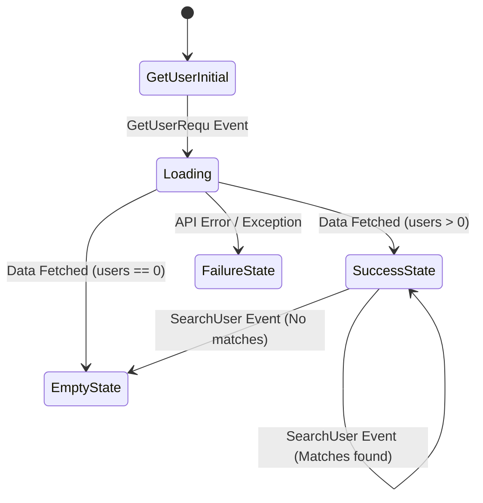

# SynRam Technical Coding Assessment — User Directory App

<p align="center">
  
  
  
  
  
</p>

---

## Overview

This application demonstrates modern Flutter development best practices by consuming remote REST API data, managing application state predictably using the **BLoC (Business Logic Component)** pattern, and delivering a responsive, user-friendly mobile experience.

Whether you are a technical evaluator reviewing the architecture or someone interested in how mobile apps operate, this project is crafted with clarity, clean code, and maintainability at its core.

---

## Features

- **Live Data Fetching**: Fetches real-time user records asynchronously from a remote REST API.
- **BLoC State Management**: Clean separation of UI and business logic with predictable state transitions (`Loading`, `Success`, `Empty`, `Failure`).
- **Instant Search & Filter**: Real-time client-side search to filter users by name with an instant feedback UI.
- **Pull-to-Refresh**: Native swipe-down gesture to reload and synchronize user records from the server.
- **Detailed User View**: Tap on any user card to navigate into their dedicated profile page displaying detailed information.
- **Graceful Error Handling & Fallbacks**: Handles network errors, empty states, and invalid inputs gracefully with clear visual indicators.

---

## Architecture & State Flow

The project strictly follows the **BLoC Pattern** to guarantee a clear separation of concerns:

```
[ User Action / UI ] 
         │  
         ▼ (Dispatches Event)
   [ GetUserBloc ] 
         │  
         ├─► [ ApiService ] ──► [ REST API (JSONPlaceholder) ]
         │                              │
         │◄──── (Parses UserModel) ─────┘
         │  
         ▼ (Emits New State)
[ BlocBuilder in UI ] ──► Updates UI Reactively
```

### Event & State Lifecycle



- **Events**:
  - `GetUserRequ`: Triggers network request to load user list.
  - `SearchUser`: Filters loaded users based on user search query.
- **States**:
  - `GetUserInitial`: Idle starting state.
  - `Loading`: Displays circular progress indicators while fetching.
  - `SuccessState`: Renders user cards.
  - `EmptyState`: Informs the user when no data or search matches exist.
  - `FailureState`: Catches exceptions and displays error descriptions.

---

## Project Structure

```
lib/
├── main.dart               # App entrypoint & MaterialApp configuration
├── api_service/
│   └── api_service.dart    # HTTP client & REST API calls
├── bloc/
│   ├── get_user_bloc.dart  # Core Business Logic Component
│   ├── get_user_event.dart # BLoC Event definitions
│   └── get_user_state.dart # BLoC State definitions
├── src/
│   ├── homa_page.dart      # Main screen: search bar, pull-to-refresh & user list
│   └── detail_page.dart    # Profile detail view for selected user
└── user_model/
    ├── user_model.dart     # Primary user data model
    ├── address.dart        # Address sub-model
    ├── company.dart        # Company sub-model
    └── geo.dart            # Geolocation coordinates sub-model
```

---

## API Reference

The app connects to the public **JSONPlaceholder** test API:

| Method | Endpoint | Description |
| :--- | :--- | :--- |
| `GET` | `https://jsonplaceholder.typicode.com/users` | Retrieves a list of 10 mock user profiles with addresses, contacts, and company information. |

---

## Tech Stack & Dependencies

| Technology | Purpose |
| :--- | :--- |
| [Flutter](https://flutter.dev/) | Cross-platform mobile UI framework |
| [Dart](https://dart.dev/) | Client-optimized language for multi-platform apps |
| [flutter_bloc](https://pub.dev/packages/flutter_bloc) `^9.1.1` | Predictable state management library |
| [bloc](https://pub.dev/packages/bloc) `^9.2.1` | Core BLoC logic and stream handling |
| [http](https://pub.dev/packages/http) `^1.6.0` | Making composable HTTP network requests |

---
---

<p align="center">
  Crafted with ❤️ using Flutter & BLoC
</p>